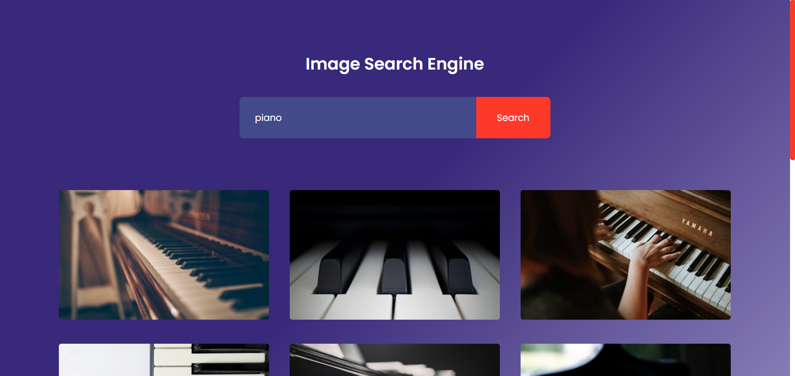

# 📸 Image Search Engine (Unsplash API + Node Backend)

<!-- GitHub Stats -->


<!-- Deployment Badges -->


<!-- Project Features -->


-brightgreen)

A **modern, full-stack Image Search Engine** leveraging the Unsplash API via a secure Node.js backend. This project delivers a fast, responsive user experience with infinite-style pagination, demonstrating best practices in front-end development (HTML, CSS, JavaScript) and secure API key management (Node.js/Express).

---

## 🚀 Live Demo & Deployment

The application is split into two separately deployed components, showcasing a modern service-oriented architecture.

| Component | Deployment Platform | URL |
| :--- | :--- | :--- |
| **🌐 Frontend (Client)** | **Vercel** | [https://image-search-engine-sooty.vercel.app](https://image-search-engine-sooty.vercel.app) |
| **⚙️ Backend (API Proxy)** | **Render** | [https://image-search-engine-2.onrender.com](https://image-search-engine-2.onrender.com) |

---

## 📸 Screenshot



---

## ✨ Features

| Feature | Description |
|:---|:---|
| **Secure Image Search** | Fetches high-quality images using the Unsplash API, with the API key securely stored on the server and API requests handled through a Node.js/Express backend. |
| **Infinite-Style Pagination** | Uses a **Show More** button to load additional image results without refreshing the page. |
| **Optimized User Experience** | Includes loading indicators to provide visual feedback while fetching images, especially during initial backend spin-up on Render's free tier. |
| **Fully Responsive Design** | Displays images in a dynamic grid layout on desktops and an optimized, stacked layout on mobile devices. |
| **Direct Image Linking** | Allows users to click on any image to open its original photo page on Unsplash in a new browser tab. |

---

## ⚙️ Technologies Used

<!-- Tech Stack -->


This project utilizes a standard MERN-stack architecture (without MongoDB) for a complete full-stack experience.

---

## 🛠️ Technologies Used

> 🌐 Frontend

| Technology | Purpose |
|:---|:---|
| **HTML5** | Structures the website's content and layout. |
| **CSS3** | Handles styling, layouts, and responsive design. |
| **JavaScript (Vanilla JS)** | Manages UI interactions, image rendering, and communication with the backend. |

> 🖥️ Backend

| Technology | Purpose |
|:---|:---|
| **Node.js** | Provides the server-side JavaScript runtime environment. |
| **Express.js** | Handles API routing and manages requests between the frontend and Unsplash API. |
| **dotenv** | Securely manages environment variables, including the Unsplash API key. |

> 🔗 External API

| Service | Purpose |
|:---|:---|
| **Unsplash API** | Provides high-quality images and image search functionality. |

> ☁️ Deployment & Hosting

| Platform | Purpose |
|:---|:---|
| **Vercel** | Hosts and deploys the frontend application. |
| **Render** | Hosts and deploys the Node.js/Express backend API service. |

---

## 🛠️ Setup & Local Installation

Follow these steps to get the project running on your local machine.

---

### **1. 🔑 Unsplash API Key**

- Go to [Unsplash Developers](https://unsplash.com/developers) and create a new application.
- Obtain your **Access Key**. You will need this for the backend setup.

---

### **2. Project Clone**

```sh
git clone https://github.com/TonyStark-19/Image-Search-Engine.git
cd Image-Search-Engine
```

---

### ***3. 🖥️ Backend Setup (Node + Express)***

```sh
# Go to the backend directory
cd backend

# Install dependencies
npm install

# Create a .env file and add your Unsplash Access Key
echo "UNSPLASH_KEY=YOUR_ACCESS_KEY_HERE" > .env

# Start the server
npm start
```
The backend API will run on http://localhost:3000.

---

### 4. 🌐 Frontend Setup (HTML, CSS, JS)
The frontend is a static web application.

```sh
# Go to the frontend directory
cd frontend
```

---

**Configuration:** Before opening the frontend, you must update the API endpoint it uses.

- Open `script.js.`
- Locate the base URL for the API call and change it from the deployed Render URL to your local backend address: `http://localhost:3000.`

Run: Simply open `index.html` in your web browser or use a live server extension (like VS Code's Live Server).

---

### 🎯 How to Use (Client Walkthrough)

1.  **Search:** Enter any keyword (e.g., "nature," "abstract," "coffee") in the search bar and press **Enter** or click **Search**.
2.  **View:** Image results will populate the screen in a responsive grid.
3.  **Details:** Click on any image tile to be directed to the full-size image on the Unsplash website.
4.  **Pagination:** Click the **"Show More"** button at the bottom of the results to fetch the next set of images.

---

## 🤝 Contributing

Contributions are welcome! If you find a bug or have a suggestion for an improvement:

1.  Fork the repository.
2.  Create a new branch (`git checkout -b feature/AmazingFeature`).
3.  Commit your changes (`git commit -m 'Add some AmazingFeature'`).
4.  Push to the branch (`git push origin feature/AmazingFeature`).
5.  Open a Pull Request.

---

## 📜 License

This project is licensed under the **MIT License** – which means you are free to use, modify, and distribute the code for personal or commercial purposes with proper attribution.

See the [LICENSE](LICENSE) file for full details.

---

Made with ❤️ by [Aditya Chandel](https://github.com/TonyStark-19)